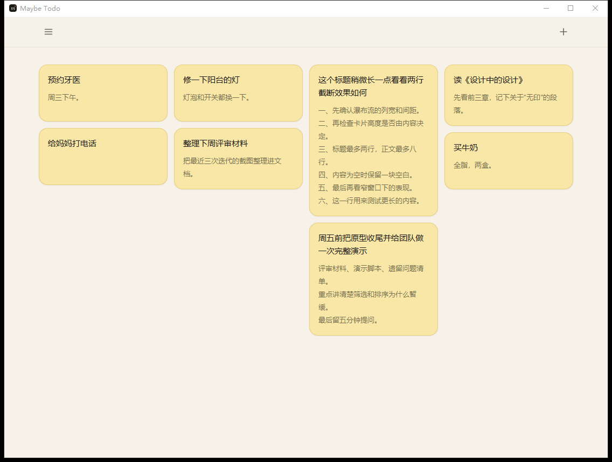
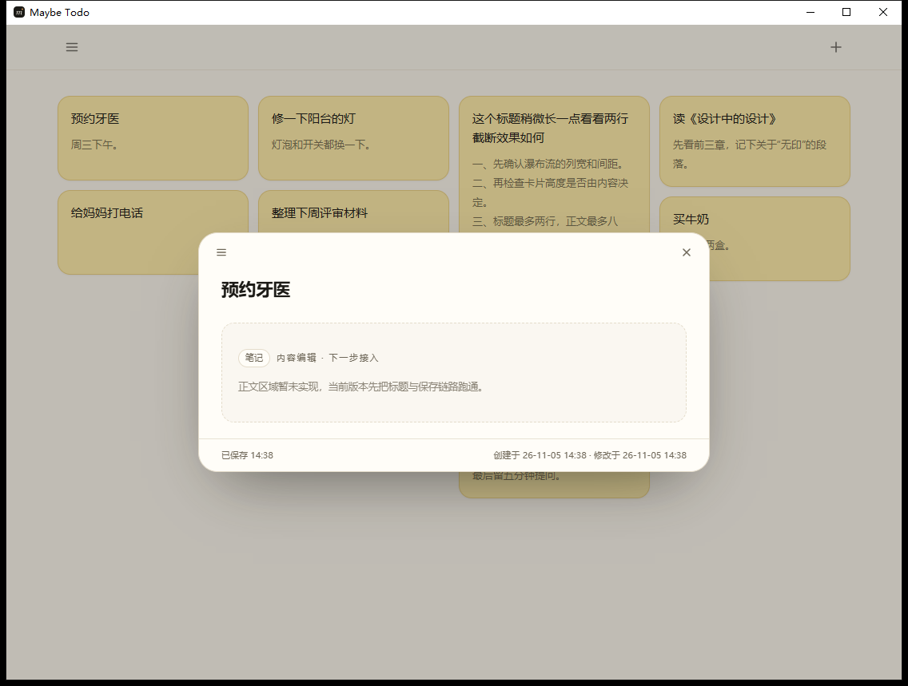

# Maybe Todo

一个很轻的、本地优先的便签 / 待办应用。

当前版本：四列瀑布流、标题自动保存、悬停菜单、锁定与回收站已经可用；正文和待办清单编辑留到下一步。

> 先记下来，再决定。

## 界面





> 截图为验证瀑布流时注入的示例正文；正文编辑尚未接入，实际新建便签的内容区为空。

## 当前可用

- 启动页：最短 300ms、最长 1.5s，数据就绪即进入首页。
- 首页便签墙：四列瀑布流，列宽固定、卡片高度随标题和内容变化；卡片只显示标题和内容区域（正文编辑待接入）。
- 功能菜单、新建菜单：鼠标悬停展开。
- 新建笔记 / 新建待办：标题 30 个字符上限，输入 500ms 后自动保存，关闭时立即落盘。
- 保存状态：浮窗底部显示「保存中… / 已保存 HH:mm / 保存失败，点击重试」。
- 详情浮窗：标题编辑、创建/修改时间、锁定开关、删除到回收站。
- 回收站：恢复、彻底删除、清空；删除 30 天后启动时自动清理。
- 数据持久化：本地 JSON 文件，重启后便签、排序、锁定状态、回收站内容都保留。
- 仅浅色主题；设置页、关于页在菜单中保留置灰入口。

## 暂未实现

- 正文编辑、待办清单子项、进度统计（浮窗内显示占位）。
- 首页类型筛选、手动拖拽排序。
- 搜索、截止日期、提醒、重复任务、优先级、标签、附件。
- 深色模式、字号设置、多语言。
- 导出 / 导入（后续补自动备份与导出）。
- 多端同步、账号、多窗口。
- SQLite（当前实现为 JSON 文件，见下文「已知问题」）。

## 技术栈

| 层 | 选型 |
| --- | --- |
| UI | React 19 + TypeScript |
| 构建 | Vite 8 |
| 样式 | Tailwind CSS v4 |
| 桌面壳 | Tauri 2（Rust） |
| 存储 | Rust + serde_json 本地文件（接口已隔离，后续可替换 SQLite） |

## 数据位置

- 桌面端（正常安装）：`%APPDATA%\com.maybetodo.app\maybe-todo.json`
- 开发脚本（本机受限环境）：`.appdata\maybe-todo.json`（通过 `MAYBE_TODO_DATA_DIR`）
- WebView 配置目录：默认 `%LOCALAPPDATA%\com.maybetodo.app\webview`；开发脚本用 `.webview-data`。

存储写入方式：先写 `maybe-todo.json.tmp`，把旧文件备份为 `.bak`，再替换目标文件；读取到更高版本号时拒绝加载，不覆盖原文件。

## 开发

```bash
npm install

# 纯浏览器预览（localStorage 降级）
npm run dev            # http://localhost:1420

# 桌面窗口（普通机器）
npm run desktop

# 本机推荐：处理 WebView2 / 沙箱数据目录问题，数据写入工作区
npm run desktop:local

# 生产构建
npm run build
npm run bundle

# Rust 测试（JSON 存取往返、排序）
cargo test --manifest-path src-tauri/Cargo.toml
```

## 目录

```
.
├─ src/
│  ├─ App.tsx                 # 首页 / 回收站 / 浮窗编排
│  ├─ types.ts                # Note 实体
│  ├─ components/             # Header、卡片、浮窗、回收站、确认框、图标
│  ├─ hooks/useMenu.ts        # 悬停 / 点击开合菜单
│  ├─ lib/repo.ts             # Tauri invoke / localStorage 双实现
│  ├─ lib/format.ts           # 时间、字素计数、回收站剩余天数
│  └─ lib/preview.ts          # 卡片缩略内容与进度
├─ src-tauri/
│  ├─ src/store.rs            # JSON 存储 + Tauri 命令
│  ├─ src/lib.rs              # 窗口创建、命令注册
│  └─ tauri.conf.json
├─ docs/
│  ├─ maybe-todo原型.md       # v1 原型定稿
│  └─ 原型缺口分析.md
└─ scripts/dev-desktop.cmd
```

## 已知问题

1. **本机 WebView2 数据目录**：`%LOCALAPPDATA%\com.maybetodo.app` 创建可能被拒绝，或 WebView2 初始化返回 `0x8000FFFF`。`scripts/dev-desktop.cmd` 已把 WebView 配置目录改到工作区 `.webview-data`（Tauri 会强制使用自己的 dataDirectory，所以代码在 `setup` 里手动建窗并传入绝对路径）。普通开发机可直接用 `npm run desktop`。
2. **bundled SQLite 编译失败**：本机 MSVC 14.44 编译 `sqlite3.c` 时报 `D8050`（`c1.dll` 无法执行），因此当前先用 JSON 文件存储；实体字段、命令接口与前端仓储层已隔离，后续可替换为 SQLite。
3. 浏览器预览模式只用于调试，数据在 localStorage，清缓存会丢。

## 下一步

1. 接入正文编辑与待办清单（content 结构见 `docs/maybe-todo原型.md`）。
2. 加回首页类型筛选与拖拽排序。
3. 用 SQLite 替换 JSON 存储，保留当前命令接口。
4. 自动备份、导出 JSON、搜索、设置页。
